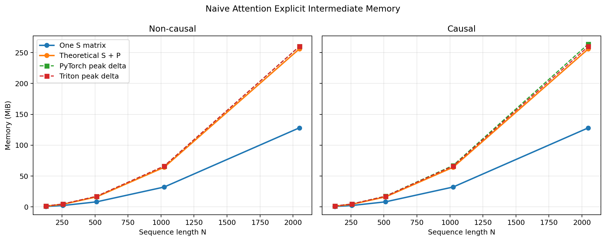
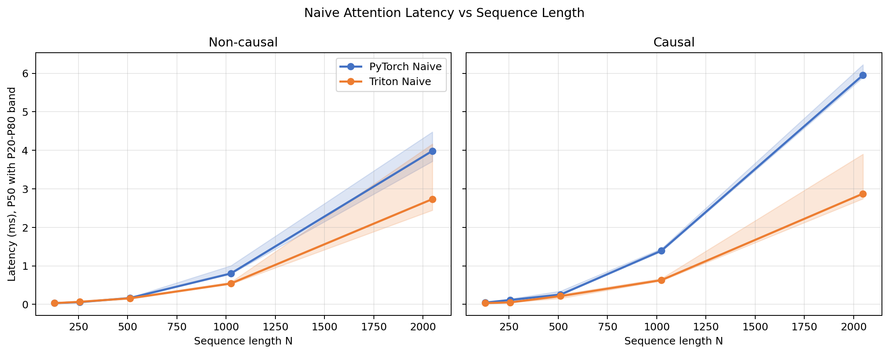

# 05_attention_naive：从正确性基线到显式中间矩阵代价的完整推理链

> 完成日期：2026-07-21  
>
> 核心目标：用显式 `QK^T -> Softmax -> P@V` 建立可信的 Attention 正确性基线，并用可复现实验证明 `N×N` 分数矩阵和概率矩阵带来的容量、流量与延迟代价。  
>
> 当前边界：本阶段只完成 Naive Attention forward，不实现后续阶段的融合算法。

## 一句话总览

本阶段从 PyTorch 显式参考实现出发，把 Attention 拆成三个可独立检查的 Triton Kernel：Score、逐行 Softmax 和 Output。

每个阶段先单独做正确性测试，再串联完整计算图，最终达到 `73 passed`。

Benchmark 固定 `B=2、H=8、D=64、FP16`，只扫描序列长度 `N=128～2048` 和因果开关。

数据证明：

- 单个 S 或 P 的容量严格按 `BHN^2` 增长，`N` 每翻倍容量变为四倍；
- Triton 的峰值显存约等于 `S+P+O`，而 PyTorch 因果参考还额外保存一个 `N×N` 布尔遮罩。
- Triton 在中大序列上取得有竞争力的 P50，但小序列存在固定开销，部分大序列点还有明显波动，因此当前成果是“正确、可测、可解释的基线”，不是长序列场景的最终高性能解。

完整决策链：

```text
理解 Q/K/V 与 [B,H,N,D]
-> 手算 QK^T、scale、causal mask、row-wise softmax、P@V
-> 编写 PyTorch 显式参考，保留 S/P
-> 先实现 Triton Score Kernel 并独立测试
-> 发现 FP32 默认点积精度导致严格测试失败
-> 显式改用 IEEE FP32 后闭环
-> 实现并独立测试逐行 Softmax Kernel
-> 实现并独立测试 P@V Kernel
-> 串联完整 Naive Attention
-> 补普通、非对齐、dtype、mask、错误输入和空序列测试
-> Benchmark PyTorch Naive 与 Triton Naive
-> 分析 N^2 容量、延迟、因果开销和峰值显存
-> 形成后续实现可依赖的 correctness baseline
```

---

## 1. 阶段目标与最终产物

本阶段实现四维 CUDA Tensor 上的自注意力 forward：

```text
Q, K, V: [B,H,N,D]
O:       [B,H,N,D]
```

目录产物：

| 文件 | 用途 |
| --- | --- |
| [`kernel.py`](./kernel.py) | PyTorch 显式参考、三个 Triton Kernel、完整 `naive_attention` 接口 |
| [`test_correctness.py`](./test_correctness.py) | 分阶段、完整链路、dtype、边界、遮罩和错误输入测试 |
| [`benchmark.py`](./benchmark.py) | PyTorch/Triton 端到端延迟与峰值显存 Benchmark |
| [`benchmark_results/attention-naive.csv`](./benchmark_results/attention-naive.csv) | 十个测试点的原始分位数、容量和峰值显存 |
| [`benchmark_results/attention-naive-latency.png`](./benchmark_results/attention-naive-latency.png) | 因果/非因果延迟曲线与 P20～P80 阴影 |
| [`benchmark_results/attention-naive-memory.png`](./benchmark_results/attention-naive-memory.png) | 理论中间容量与实际峰值显存曲线 |

最终正确性结果：

```text
73 passed
```

---

## 2. 数学定义与手算示例

### 2.1 数学定义

缩放点积注意力：

```text
S = QK^T / sqrt(D)
P = softmax(mask(S), dim=-1)
O = PV
```

元素公式：

```text
S[b,h,i,j]
= sum(d=0...D-1) Q[b,h,i,d] * K[b,h,j,d] / sqrt(D)

P[b,h,i,j]
= exp(S[b,h,i,j] - row_max) / row_exp_sum

O[b,h,i,d]
= sum(j=0...N-1) P[b,h,i,j] * V[b,h,j,d]
```

下标语义：

```text
b：batch
h：attention head
i：query 位置
j：key/value 位置
d：head 内特征位置
```

Softmax 必须沿最后一个 `j` 维执行，因为固定一个 query `i` 后，需要在所有 key `j` 之间分配概率：

```text
sum_j P[b,h,i,j] = 1
```

### 2.2 3×2 手算

设 `B=H=1、N=3、D=2`：

```text
Q = K =
[[1,0],
 [0,1],
 [1,1]]

V =
[[1,0],
 [0,1],
 [1,1]]
```

第一步：

```text
QK^T =
[[1,0,1],
 [0,1,1],
 [1,1,2]]
```

第二步，`scale=1/sqrt(2)≈0.707`：

```text
S ≈
[[0.707,0,    0.707],
 [0,    0.707,0.707],
 [0.707,0.707,1.414]]
```

第三步，使用 causal mask，把 `j>i` 的未来位置设为 `-inf`：

```text
S_causal ≈
[[0.707,-inf, -inf],
 [0,     0.707,-inf],
 [0.707, 0.707,1.414]]
```

第四步，逐行 Softmax：

```text
P[0] = [1, 0, 0]
P[1] ≈ [0.330, 0.670, 0]
P[2] ≈ [0.248, 0.248, 0.503]
```

第五步，`O=PV`：

```text
O[0] = [1,0]
O[1] ≈ 0.330*[1,0] + 0.670*[0,1]
     ≈ [0.330,0.670]
O[2] ≈ [0.751,0.751]
```

可复述结论：

```text
Q/K 决定“关注谁”；
Softmax 把匹配分数变成每行和为 1 的概率；
V 决定“真正取走什么信息”；
causal mask 让未来位置既不获得概率，也不进入 Softmax 分母。
```

---

## 3. Shape 映射

输入布局：

```text
Q, K, V: [B,H,N,D]
```

Score：

```text
Q:   [B,H,N,D]
K^T: [B,H,D,N]
S:   [B,H,N,N]
```

其中 `B/H` 是相互独立的批次维，`D` 是点积归约维度。总共有 `B×H` 组独立的 `N×N` 注意力矩阵。

Output：

```text
P: [B,H,N,N]
V: [B,H,N,D]
O: [B,H,N,D]
```

这里 `j/N` 是归约维度。当前实现要求 Q/K/V shape 完全一致，因此属于最小自注意力接口，没有支持 `N_q != N_k` 或 `D_v != D`。

---

## 4. Program、Tile 与数据范围映射

### 4.1 Score Kernel

固定配置：

```text
BLOCK_M = 32：query tile
BLOCK_N = 32：key tile
BLOCK_D = 32：head_dim 归约 tile
num_warps = 4
```

三维 grid：

```text
axis 0 = cdiv(N, BLOCK_M)
axis 1 = cdiv(N, BLOCK_N)
axis 2 = B*H
```

一个 program 计算 S 的一个 `[BLOCK_M,BLOCK_N]` tile。`D` 不增加 program 数，只决定 program 内循环：

```text
d_loops = cdiv(D, BLOCK_D)
```

`pid_bh` 的还原：

```text
batch_idx = pid_bh // H
head_idx  = pid_bh % H
```

K 没有在 Global Memory 中真实转置。Kernel 通过 stride 地址生成 `[BLOCK_D,BLOCK_N]` 的逻辑转置 tile，避免额外保存完整 `K^T`。

### 4.2 Softmax Kernel

```text
grid = (B*H*N,)
```

一个 program 负责固定 `(b,h,i)` 的完整 score 行：

```text
scores[b,h,i,:]
```

逻辑宽度：

```text
BLOCK_SIZE = next_power_of_2(N)
```

非 2 的幂位置使用 mask，加载填充值为 `-inf`。例如 `N=17` 时，逻辑宽度为 32，其中 17 个有效位置、15 个 padding 位置。

### 4.3 Output Kernel

固定配置：

```text
BLOCK_M = 32：query tile
BLOCK_D = 32：输出特征 tile
BLOCK_K = 32：key/value 归约 tile
num_warps = 4
```

三维 grid：

```text
axis 0 = cdiv(N, BLOCK_M)
axis 1 = cdiv(D, BLOCK_D)
axis 2 = B*H
```

一个 program 计算 O 的 `[BLOCK_M,BLOCK_D]` tile，内部执行：

```text
P tile [BLOCK_M,BLOCK_K]
@
V tile [BLOCK_K,BLOCK_D]
```

归约循环数：

```text
k_loops = cdiv(N, BLOCK_K)
```

### 4.4 三阶段对照

| 阶段 | Program 输出范围 | 归约维度 | Program 数量 |
| --- | --- | --- | --- |
| Score | S 的 `32×32` tile | D | `cdiv(N,32)^2 × B×H` |
| Softmax | P 的一整行 | N/key | `B×H×N` |
| Output | O 的 `32×32` tile | N/key | `cdiv(N,32)×cdiv(D,32)×B×H` |

---

## 5. 数值稳定性与 Mask 边界

### 5.1 Scale

点积包含 D 项累加。D 增大时，未缩放分数幅度通常增大，Softmax 更容易过早饱和。因此使用：

```text
scale = 1/sqrt(D)
```

### 5.2 Safe Softmax

Softmax Kernel 使用：

```text
m = max(row)
numerator = exp(row - m)
denominator = sum(numerator)
P = numerator / denominator
```

减去行最大值不改变概率，却能保证最大指数为 1，降低指数溢出风险。

### 5.3 Causal Mask

规则：

```text
j <= i：允许
j > i：未来位置，禁止
```

必须在 Softmax 前把未来分数设为 `-inf`。如果先 Softmax 再把未来概率清零，剩余概率和会小于 1，除非额外重新归一化。

### 5.4 Padding Mask

三个 Kernel 都要处理非对齐边界：

- Score：越界 Q/K 输入按 0 加载，越界 S 不写回；
- Softmax：越界 key 按 `-inf` 加载，确保 max 和 sum 不受影响；
- Output：越界 P/V 按 0 加载，越界 O 不写回。

### 5.5 FP32 点积精度失败与修正

初始 Score Kernel 使用默认 `tl.dot`。测试结果为：

```text
FP16：通过
BF16：通过
FP32：4 项失败
最大绝对误差约 0.0027～0.0038
```

原因不是 shape 或地址错误，而是 FP32 输入的点积精度口径：默认路径与严格 IEEE FP32 参考存在约 `1e-3` 差异。最终显式设置：

```python
input_precision="ieee"
```

测试随后全部通过。这个决策优先保证 correctness baseline 的精度口径一致；它不意味着 IEEE 一定是性能最优路径。后续如果研究性能，应把输入精度策略作为显式实验变量，而不是偷偷放宽容差。

---

## 6. Global Memory 与中间张量生命周期

完整生命周期：

```text
Q/K
-> Score Kernel
-> 写 S [B,H,N,N] 到 Global Memory
-> Softmax Kernel 读取 S
-> 写 P [B,H,N,N] 到 Global Memory
-> Output Kernel 读取 P 和 V
-> 写 O [B,H,N,D]
```

设每元素 `s` Bytes：

```text
S 容量 = B*H*N^2*s
P 容量 = B*H*N^2*s
S+P    = 2*B*H*N^2*s
O 容量 = B*H*N*D*s
```

只计算 S/P 跨阶段的最基本语义流量：

```text
写 S + 读 S + 写 P + 读 P
= 4*B*H*N^2*s Bytes
```

再加上 Q/K/V/O 的最小唯一张量流量：

```text
Q + K + V + O = 4*B*H*N*D*s Bytes
```

因此可定义一个源码级最低语义流量口径：

```text
Bytes_semantic
= 4*B*H*(N^2 + N*D)*s
```

这个数不能解释为真实 DRAM bytes。Tiled MatMul 中相同 Q/K/P/V 数据可能被多个 programs 请求，也可能命中 L2；真实内存事务必须由 profiler 测量。

---

## 7. 输入契约、Correctness 与工程边界

### 7.1 当前输入契约

完整接口要求：

- Q/K/V 是 CUDA Tensor；
- Q/K/V 是四维 `[B,H,N,D]`；
- 三者 shape、dtype、device 完全一致；
- dtype 为 FP16、BF16 或 FP32；
- `head_dim > 0`；
- `causal` 和 `return_intermediates` 必须是 bool；
- Softmax 输入必须为 `[B,H,N,N]`，且最后一维连续；
- 空序列 `N=0` 安全返回。

### 7.2 73 项测试组成

```text
12 项 PyTorch 显式参考测试
12 项 Triton Score Kernel 测试
12 项 Triton Softmax Kernel 测试
12 项 Triton P@V Kernel 测试
12 项完整 Naive Attention 逐层测试
13 项错误输入与空序列测试
= 73 passed
```

覆盖内容：

- 对齐 shape：`[1,2,32,32]`；
- 非对齐 shape：`[2,4,17,8]`；
- FP16、BF16、FP32；
- causal=False/True；
- S/P/O 逐层对齐；
- 每行概率和约等于 1；
- causal 上三角概率严格为 0；
- CPU、维度、shape、dtype、参数和布局错误；
- 空序列。

浮点容差：

```text
FP16：atol=rtol=2e-2
BF16：atol=rtol=5e-2
FP32：atol=rtol=1e-4
```

---

## 8. Benchmark 环境、计时范围与指标

### 8.1 环境

沿用当前项目环境记录：

```text
GPU：NVIDIA GeForce RTX 5060 Laptop GPU
SM count：26
VRAM：约 7.96 GiB
PyTorch：2.11.0+cu128
Triton：3.6.0
CUDA：12.8
运行环境：WSL / Laptop GPU
Benchmark dtype：FP16
```

Laptop 动态频率、功耗、温度、桌面负载和 WSL 调度可能影响微秒级结果。

### 8.2 Provider

```text
PyTorch Naive：torch.matmul -> scale/masked_fill -> torch.softmax -> torch.matmul
Triton Naive：Score Kernel -> Softmax Kernel -> Output Kernel
```

PyTorch SDPA 没有进入本轮 Benchmark，因为它可能选择不同算法后端，不再保证显式物化完整 S/P；本实验需要保持“相同朴素算法语义”的比较口径。

### 8.3 控制参数

```text
B=2
H=8
D=64
dtype=FP16
N=128/256/512/1024/2048
causal=False/True
```

### 8.4 计时范围

```text
warmup = 100 ms
rep = 300 ms
quantiles = P20/P50/P80
```

计时包含：

```text
Python wrapper
+ S/P/O 分配
+ 三次 kernel launch 或 PyTorch 对应操作
+ kernel 执行
```

输入 Q/K/V 在计时区间外创建。正式计时前完成 correctness 和 Triton JIT，因此结果表示已编译后的稳态算子级延迟，不包含首次编译成本。

### 8.5 峰值显存口径

测量前记录当前活跃显存并重置峰值统计，运行一次 provider 后计算：

```text
peak_delta = max_memory_allocated - baseline_memory_allocated
```

因此 Q/K/V 已存在于 baseline，不计入增量；峰值增量主要反映 S/P/O 和临时张量。CUDA 缓存分配器保留但未激活的内存不等于 `memory_allocated`。

### 8.6 MatMul-equivalent TFLOPS

两个 MatMul 的计算量：

```text
QK^T：2*B*H*N^2*D FLOPs
P@V： 2*B*H*N^2*D FLOPs
合计：4*B*H*N^2*D FLOPs
```

指标：

```text
MatMul-equivalent TFLOPS
= 4*B*H*N^2*D / latency_ms * 1e-9
```

该口径忽略 Softmax 中 max、减法、exp、sum 和除法，不是整个 Attention 的精确硬件指令计数；它只用于在相同 shape 和算法语义下比较端到端计算吞吐。

---

## 9. 实验一：序列长度与平方增长

### 9.1 实验问题

显式 S/P 容量理论上为 `O(N^2)`，两个 MatMul 计算量也为 `O(N^2D)`。实验要验证：固定 B/H/D 后，序列长度翻倍是否让容量严格变成四倍；延迟是否逐渐从固定开销区进入接近平方增长的区域；Triton 是否在所有 N 上都比 PyTorch 快。

### 9.2 控制变量

固定：

```text
B=2, H=8, D=64
FP16
相同随机输入
相同 warmup/rep/quantiles
相同显式 S/P 算法语义
```

先使用 `causal=False` 排除因果遮罩创建和判断的额外差异，只改变：

```text
N=128/256/512/1024/2048
```

这样容量、MatMul 计算量和 Softmax 行宽的主要变化都来自 N。

### 9.3 性能预测

- S/P 容量每次严格增长 4 倍；
- 小 N 受 Python、分配和三次 launch 固定开销影响，延迟不会严格增长 4 倍；
- N 增大后，两个 MatMul、Softmax 和 S/P 搬运占比提高，延迟增长应更接近 N²；
- Triton 固定 `32` tile 在小 N 上未必有优势，中大 N 更可能摊薄固定开销；
- 大 N 的片上资源、Softmax 行宽和运行状态可能扩大波动。

### 9.4 关键结果

非因果结果：

| N | PyTorch P20/P50/P80 ms | Triton P20/P50/P80 ms | Torch/Triton TFLOPS | Speedup | S+P MiB |
| ---: | --- | --- | --- | ---: | ---: |
| 128 | `0.0275/0.0314/0.0316` | `0.0284/0.0315/0.0326` | `2.140/2.133` | 0.997x | 1 |
| 256 | `0.0532/0.0553/0.0581` | `0.0571/0.0651/0.0861` | `4.855/4.126` | 0.850x | 4 |
| 512 | `0.1595/0.1649/0.1773` | `0.1381/0.1567/0.1791` | `6.510/6.853` | 1.053x | 16 |
| 1024 | `0.7860/0.8005/1.0023` | `0.5246/0.5401/0.5745` | `5.365/7.953` | 1.482x | 64 |
| 2048 | `3.7135/3.9839/4.4770` | `2.4444/2.7322/4.1635` | `4.312/6.288` | 1.458x | 256 |

### 9.5 现象总结

- S+P 形成严格的 `1/4/16/64/256 MiB` 四倍台阶；
- `N=128` 两者持平，`N=256` Triton 反而慢；
- `N=512` 附近出现性能交叉；
- `N=1024/2048` Triton P50 领先约 1.46～1.48x；
- 从 1024 到 2048，PyTorch/Triton P50 分别增长约 4.98x/5.06x，已经进入强烈的平方增长区；
- Triton `N=2048` 的 P20～P80 区间很宽，领先稳定性弱于 `N=1024`。

### 9.6 原因解释

小 N：

```text
N 小
-> N^2 计算和数据量小
-> 三次输出分配、wrapper 和 launch 占比较高
-> 固定 Triton tile/launch 无法形成稳定优势
```

中大 N：

```text
N 增大
-> Score/Output MatMul 计算量按 N^2D 增长
-> S/P 跨 Kernel 容量与语义流量按 N^2 增长
-> 固定开销被摊薄
-> Triton 的显式 tile 和 scale 融合开始形成优势
```

延迟增长超过 4 倍并不能单独证明 cache miss、spill 或 occupancy 下降。Softmax 行宽、program 数、缓存工作集、GPU 频率和测量波动同时变化。

### 9.7 证据边界

数据直接支持：

- 容量严格按 N² 增长；
- Triton 不是所有 N 都更快；
- 中大 N 的 P50 明显优于小 N 相对表现；
- 大 N 存在更宽波动区间。

数据不能证明：

- `N=2048` 一定发生 register spill；
- TFLOPS 下降一定由 DRAM 带宽主导；
- 某个点一定发生 L2 cache miss 或 occupancy 台阶；
- 三个 Kernel 中到底哪个阶段主导总延迟。

这些问题需要分阶段计时和 Nsight 指标。

### 9.8 当前最优解

当前范围内继续使用显式三 Kernel 版本作为 correctness baseline。它在 `N>=1024` 的本轮 P50 上有竞争力，并完整暴露 S/P 代价。固定 32 tile 尚未经过参数扫描，不能称为硬件全局最优配置；05 的当前决策是不进行 Autotune，以免把正确性基线变成参数优化项目。

### 9.9 失败实验

失败 heuristic 1：`N` 翻倍后每一个延迟点都会严格增长 4 倍。小 N 的固定开销和不同阶段占比直接推翻了“每一点严格 4 倍”。

失败 heuristic 2：Triton 手写 Kernel 一定比 PyTorch 快。非因果 `N=256` 只有 `0.850x`，说明小规模固定开销和供应商实现竞争不能忽略。

性能模型修正为：容量具有严格 N² 规律，延迟只有在主要工作占主导后才表现出近似 N² 趋势；速度胜负还由实现常数、shape 和运行状态决定。

### 9.10 面试表达

> 我固定 B=2、H=8、D=64 和 FP16，只扫描 N=128 到 2048，用相同显式 S/P 语义比较 PyTorch Naive 与三个 Triton Kernel。
>
> 预测容量会严格按 N² 增长，但小 N 延迟受分配和 launch 影响。结果 S+P 从 1 MiB 增长到 256 MiB，每次 N 翻倍严格四倍；Triton 在 128 持平、256 落后、512 交叉，到 1024/2048 的 P50 领先约 1.48x/1.46x。这推翻了“Triton 总是更快”和“所有延迟点严格四倍”的假设。当前保留固定 tile 版本作为正确性基线，但不把大 N 波动归因于 spill 或 cache miss，因为还没有分阶段 profiler 证据。

---

## 10. 实验二：因果与非因果路径

### 10.1 实验问题

因果模式中约一半未来位置最终概率为 0。实验要验证：当前 Naive Attention 是否因此减少容量或主要计算；因果判断会给 PyTorch/Triton 分别带来多少额外开销；Triton 的融合遮罩是否形成可观察收益。

### 10.2 控制变量

对每个 N 固定：

```text
B/H/D、dtype、Q/K/V、计时方法、Kernel 配置
```

只改变：

```text
causal=False -> causal=True
```

因此数学 shape、S/P 容量和两个 MatMul 的理论 FLOPs 不变，主要差异来自遮罩语义及其工程实现。

### 10.3 性能预测

- 当前两种模式都会物化完整 S/P，理论容量完全相同；
- 当前 Score Kernel 仍计算完整 `QK^T`，不能预测 causal 计算量减半；
- Triton 在 Score Kernel 内直接生成 `j<=i` 条件，额外容量很小；
- PyTorch 参考会创建 `[N,N]` bool mask 并执行 `masked_fill`，峰值容量和延迟可能更高；
- 小 N 上差异容易被固定开销和噪声覆盖。

### 10.4 关键结果

因果结果：

| N | PyTorch P20/P50/P80 ms | Triton P20/P50/P80 ms | Torch/Triton TFLOPS | Speedup | Torch/Triton peak MiB |
| ---: | --- | --- | --- | ---: | --- |
| 128 | `0.0443/0.0448/0.0452` | `0.0284/0.0313/0.0325` | `1.499/2.145` | 1.431x | `1.266/1.250` |
| 256 | `0.0951/0.1130/0.1411` | `0.0479/0.0504/0.0520` | `2.376/5.323` | 2.240x | `4.563/4.500` |
| 512 | `0.2464/0.2537/0.3449` | `0.1554/0.2144/0.2550` | `4.233/5.009` | 1.183x | `17.250/17.000` |
| 1024 | `1.3685/1.3924/1.4456` | `0.6104/0.6282/0.6690` | `3.085/6.837` | 2.216x | `67.000/66.000` |
| 2048 | `5.8923/5.9524/6.2237` | `2.7428/2.8733/3.9000` | `2.886/5.979` | 2.072x | `264.000/260.000` |

因果相对非因果的 P50 倍数：

| N | PyTorch causal/non-causal | Triton causal/non-causal |
| ---: | ---: | ---: |
| 128 | 1.43x | 0.99x |
| 256 | 2.04x | 0.78x |
| 512 | 1.54x | 1.37x |
| 1024 | 1.74x | 1.16x |
| 2048 | 1.49x | 1.05x |

### 10.5 现象总结

- 因果和非因果的理论 S/P 容量完全相同；
- PyTorch causal 在全部 N 上都比自身 non-causal 慢；
- Triton causal/non-causal 多数大点较接近，512 点有明显上升，256 点则出现反向更快的异常；
- causal 模式下 Triton speedup 为 1.18～2.24x，高于多数 non-causal 点；
- `N=1024` 两边分位区间较窄且明显分离，是较强的领先证据；
- `N=2048` Triton 区间较宽，但 Triton P80 仍低于 PyTorch P20，领先关系仍较清楚。

### 10.6 原因解释

当前算法：

```text
causal=True
-> Score 仍计算完整 N×N dot
-> 只在写 S 前把 j>i 位置改成 -inf
-> Softmax 仍处理完整逻辑行
-> P@V 仍执行完整矩阵乘法
-> 容量和主要 FLOPs 不变
```

工程路径差异：

```text
PyTorch causal
-> Python 创建 N×N bool mask
-> masked_fill 形成额外操作/临时状态

Triton causal
-> Score Kernel 内部 tl.where
-> 不创建全局 bool mask
```

这能解释为什么 PyTorch causal 峰值和延迟更高，也能解释 Triton causal 相对优势的一部分。但端到端速度差不能进一步拆成 `tl.dot`、Softmax、mask 和分配各自贡献，除非增加分阶段 Benchmark。

### 10.7 证据边界

数据直接支持：

- causal 没有降低当前 S/P 容量；
- PyTorch causal 峰值比 Triton 多一个与 N² Bytes 一致的量；
- 当前 Triton causal P50 在全部测试点领先 PyTorch causal；
- 部分测试点存在明显波动。

数据不能证明：

- causal 的下三角零值减少了 Tensor Core 实际乘法；当前代码没有结构化跳过；
- Triton 的全部领先都来自 mask fusion；
- `N=256` causal 比 non-causal 更快是稳定的硬件规律；该点很可能受运行顺序或状态影响；
- 某个具体 stall、cache 或 occupancy 指标主导差异。

### 10.8 当前最优解

当前选择把 scale 和 causal 判断融合进 Score Kernel，并继续显式写 S。这消除了独立全局 bool mask，保持基线结构简单；但它没有解决完整 S/P 容量和主要 FLOPs。对 05 来说这是正确的工程折中：保留可检查中间张量，同时不额外制造遮罩张量。

### 10.9 失败实验

失败 heuristic 1：causal 只保留下三角，所以容量应该减半。实际 S/P shape 完全不变，容量相同。

失败 heuristic 2：causal 有一半概率为 0，所以当前实现应该快约两倍。当前两个 MatMul 仍是完整矩阵计算，数据也没有显示这种结构性减半。

失败 heuristic 3：causal 一定比 non-causal 慢一个固定比例。Triton `N=256` 出现反向结果，说明微秒级测量和运行状态不能被忽略。

### 10.10 面试表达

> 我固定 shape、dtype 和计时方法，只切换 causal。预测当前 Naive 实现仍会分配并计算完整 N×N 矩阵，所以不能因为上三角概率为 0 就声称容量或计算减半。结果 causal/non-causal 的理论 S/P 完全相同；Triton 峰值保持 S+P+O，而 PyTorch causal 额外增加了恰好 N² Bytes 的布尔 mask。Triton causal 在 N=1024/2048 的 P50 分别约快 2.22x/2.07x，但我只把其中一部分归因于 mask fusion，不声称底层计算减半，也不对异常点做 cache 或 occupancy 断言。

---

## 11. 实验三：理论中间容量与实际峰值显存

### 11.1 实验问题

理论公式 `S+P=2BHN²s` 能否解释实际峰值显存？

实际峰值还包含哪些张量？

因果模式额外的 PyTorch bool mask 是否可以从数据中精确识别？

### 11.2 控制变量

固定 B/H/D/dtype 和 provider 代码，只改变 N，并在 provider 调用前：

```text
同步 GPU
重置 peak memory stats
记录当前 memory_allocated
运行一次预热后的 provider
记录 max_memory_allocated - baseline
```

Q/K/V 已在 baseline 中，不进入峰值增量。这样主要观察 provider 内部新分配的 S/P/O 和遮罩。

### 11.3 性能预测

- Triton 峰值应约等于 `S+P+O`；
- PyTorch non-causal 使用相同显式张量，峰值应接近 Triton；
- PyTorch causal 额外创建 `N×N` bool mask，峰值应再增加 `N² Bytes`；
- 所有由 N×N 决定的容量每次 N 翻倍严格增长四倍。

### 11.4 关键结果

| N | 单个 S MiB | S+P MiB | O MiB | Non-causal Torch/Triton peak | Causal Torch/Triton peak |
| ---: | ---: | ---: | ---: | --- | --- |
| 128 | 0.5 | 1 | 0.25 | `1.25/1.25` | `1.266/1.25` |
| 256 | 2 | 4 | 0.5 | `4.5/4.5` | `4.563/4.5` |
| 512 | 8 | 16 | 1 | `17/17` | `17.25/17` |
| 1024 | 32 | 64 | 2 | `66/66` | `67/66` |
| 2048 | 128 | 256 | 4 | `260/260` | `264/260` |

理论图与峰值图：



### 11.5 现象总结

- Triton 全部点严格等于或精确贴合 `S+P+O`；
- PyTorch non-causal 与 Triton 完全相同；
- PyTorch causal 比 Triton 多出的容量依次为 `0.015625/0.0625/0.25/1/4 MiB`；
- 这组差额严格等于 `N² Bytes`，对应 bool causal mask；
- N=2048 时仅 S+P 已达 256 MiB，远大于 O 的 4 MiB，说明长序列容量由 N² 中间矩阵主导。

### 11.6 原因解释

Triton：

```text
S 持有
-> P 分配并持有
-> O 分配
-> 峰值约 S+P+O
```

PyTorch causal：

```text
S/P/O
+ causal_mask [N,N] bool
-> 比 Triton 多 N² Bytes
```

随着 N 增大：

```text
S/P: O(N²)
O:   O(ND)
```

固定 D 后，O 的相对占比快速下降，峰值几乎完全由 S/P 决定。

### 11.7 证据边界

数据直接支持：当前一次调用的活跃峰值分配与张量容量公式精确对应；PyTorch causal 的额外量与 bool mask 精确一致。

数据不能证明：

- 实际 DRAM 传输了多少 Bytes；
- CUDA caching allocator 的 reserved memory 规模；
- 编译器是否生成片上临时缓冲或发生 spill；
- 不同 stream/并发请求下的生产峰值。

`max_memory_allocated` 测的是活跃分配峰值，不是硬件总线流量，也不是 `memory_reserved`。

### 11.8 当前最优解

05 保留显式 S/P，因为它们是逐层验证和理解生命周期的核心。工程上同时记录理论容量与峰值增量，避免只报一个不透明的 GPU memory 数字。它解决了基线可解释性问题，但没有解决 N² 容量本身。

### 11.9 失败实验

失败 heuristic 1：只看输出 O 的大小即可估计 Attention 显存。N=2048 时 O 只有 4 MiB，而 S+P 达 256 MiB，输出完全不是主导项。

失败 heuristic 2：因果上三角为 0，所以显存会自动减半。张量仍按完整 N×N 分配，零值不等于稀疏存储。

失败 heuristic 3：峰值显存就是真实显存流量。峰值只回答同一时刻有多少活跃分配，不能回答这些数据被读写多少次。

### 11.10 面试表达

> 我同时计算理论容量并测量 `max_memory_allocated-baseline`。固定 B=2、H=8、D=64、FP16 后，S+P 随 N 从 128 到 2048 按 1、4、16、64、256 MiB 严格增长；Triton 峰值精确贴合 S+P+O，例如 N=2048 为 260 MiB。PyTorch non-causal 相同，而 causal 多 4 MiB，恰好等于 2048² Bytes 的 bool mask。这证明当前容量瓶颈来自显式 N×N 中间矩阵，但峰值分配不等于真实 DRAM 流量，后者仍需 profiler。

---

## 12. 延迟图与总体性能观察



总体观察：

```text
小 N：固定开销主导，Triton 不保证领先
中等 N：出现 PyTorch/Triton 性能交叉
大 N：N² 工作和中间矩阵代价主导，Triton P50 领先
causal：Triton 融合 mask，PyTorch 显式 mask 路径开销更明显
```

必须同时保留的限制：

- non-causal N=2048 的分位区间有重叠；
- Triton 部分点 P20/P80 很宽；
- 当前只运行一轮完整 sweep，没有随机化 provider/N 顺序；
- 没有记录 GPU 时钟、功耗和温度；
- 没有分阶段计时 Score/Softmax/Output。

---

## 13. 从初始 Baseline 到最终版本的决策链

| 阶段 | 问题/观察 | 性能或正确性模型修正 | 决策 |
| --- | --- | --- | --- |
| PyTorch reference | 需要能观察 S/P，而不是只得到 O | 中间张量是正确性定位点，也是容量成本 | 返回 O/S/P |
| Score Kernel | B/H/N/D 映射容易混淆 | B×H 决定独立矩阵，N×N 决定输出 tile，D 只决定归约循环 | 三维 grid + D loop |
| FP32 测试 | FP16/BF16 通过，FP32 严格测试失败 | 默认点积精度与 IEEE 参考不同 | `input_precision="ieee"` |
| Softmax Kernel | 必须按 key 维归一化 | 一个 program 负责固定 `(b,h,i)` 的一行 | grid=`B×H×N` |
| Causal mask | 先 Softmax 后清零会破坏行和 | mask 必须进入 Softmax 分母之前 | Score 中写 `-inf` |
| Output Kernel | P@V 的归约维不是 D | 输出 N/D 决定 grid，key N 决定 K loop | 三维 grid + N loop |
| 完整正确性 | 只看 O 会隐藏中间错误 | S/P/O 应逐层比较 | 73 项测试 |
| Sequence Benchmark | Triton 不在所有 N 上领先 | 固定开销与 N² 工作占比随 N 变化 | 不宣称普适加速 |
| Causal Benchmark | causal 没有容量减半 | 零值不等于稀疏存储或跳过计算 | 保留完整 S/P 结论 |
| Peak memory | 峰值与流量容易混淆 | 分配容量和 DRAM traffic 是不同指标 | 同时报理论容量与 peak delta |

最终核心结论：

```text
Naive Attention 的价值是可观察、可逐层验证；
它的根本代价是完整物化 S/P，容量和主要跨阶段流量按 N² 增长；
Triton 可以优化常数和融合 scale/mask，但没有改变当前算法的 N² 中间矩阵；
没有分阶段计时和 profiler 时，不把端到端速度差包装成具体硬件机制。
```

---

## 14. 算法正确、工程可用与性能优秀

### 14.1 算法正确

要求：

- `S=QK^T/sqrt(D)`；
- Softmax 沿 key 维；
- causal 的 `j>i` 概率为 0；
- `O=PV`；
- 浮点误差在合理容差内。

当前已达到。

### 14.2 工程可用

要求：

- 明确 shape/dtype/device 契约；
- 普通、非对齐、不同 dtype 和错误输入测试；
- 空输入安全返回；
- 可重复 Benchmark；
- 结果、限制和错误信息清楚。

当前达到“教学工程基线”级别，但还没有 backward、任意 mask、dropout、通用 Q/K/V shape 和系统化非连续布局支持，不能称为生产级完整算子。

### 14.3 性能优秀

要求不只是比某个 PyTorch eager 路径快，还需要：

- 避免或显著减少 N² 中间矩阵；
- 控制真实 Global Memory traffic；
- 在多 shape/dtype/硬件上稳定；
- 有分阶段计时和 profiler 证据；
- 处理长序列、资源压力和生产接口。

当前没有达到。中大 N 的 P50 加速只是“当前硬件、当前 shape、当前 provider”上的证据，不能抵消 N² 容量问题。

---

## 15. 为什么 Naive Attention 是可信的 Correctness Baseline

三个中间结果都能单独检查：

```text
S：检查 QK^T、scale、shape、causal -inf
P：检查 Softmax 维度、每行和、未来位置 0
O：检查 P@V
```

它的数学表达直接、没有隐藏状态，错误容易定位。后续任何保持相同 Attention 语义的实现，都必须在相同输入、dtype 和 mask 下与本基线输出保持合理浮点容差内一致。

基线的意义不是“慢代码”，而是：

```text
语义清晰
+ 中间状态可观察
+ 测试覆盖完整
+ 浮点口径明确
+ 性能和显存代价已经量化
```

---

## 16. 当前支持范围与限制

已覆盖：

- CUDA forward；
- `[B,H,N,D]` 自注意力；
- FP16/BF16/FP32；
- FP32 IEEE dot；
- causal/non-causal；
- N/D 非 32 整数倍；
- 空序列；
- 显式 stride 地址计算；
- 返回 O 或 O/S/P；
- 73 项 correctness；
- P20/P50/P80、等效 TFLOPS、speedup；
- 理论 S/P 容量和峰值显存增量；
- CSV/PNG。

仍未覆盖：

- backward；
- dropout；
- padding mask、任意 additive mask；
- cross-attention；
- `D_v != D`；
- 不同 Q/K/V 序列长度；
- 任意非连续布局的系统测试；
- Softmax 超过单 program 上限后的分块方案；
- BLOCK/warp/stage 参数 sweep 与 Autotune；
- Score/Softmax/Output 分阶段 Benchmark；
- 多轮随机化测量顺序；
- Nsight 对 DRAM bytes、L2、register、spill、occupancy、Tensor Core 指令和 stall 的验证；
- 生产级异常恢复和多 GPU 行为。

---

## 17. 当前最优工程决策

当前不是“找到全局最快配置”，而是形成最适合 05 目标的实现：

```text
PyTorch reference：提供独立标准答案
Score/Softmax/Output 三 Kernel：逐层可测
固定 32 tile + w4：简单、可解释、覆盖边界
FP32 IEEE：严格对齐正确性口径
scale + causal 融合进 Score：避免独立全局 bool mask
显式 S/P：保留 correctness 和 IO 代价基线
```

它解决了正确性定位、工程契约和代价量化问题；无法解决 N² 中间矩阵、长序列显存和跨 Kernel 流量问题。

---

## 18. 总体面试表达

> 我先用 `[B,H,N,D]` 明确 Attention 的 shape 语义，把计算拆成 `S=QK^T/sqrt(D)`、逐行 Softmax 和 `O=PV`，并用 PyTorch 显式保存 S/P 作为参考。Triton 端分别实现三个 Kernel：Score 用三维 grid 映射 query tile、key tile 和 B×H，沿 D 归约；Softmax 一个 program 处理一整行；Output 对 N/D 输出 tile 分块，沿 key N 归约。每个阶段先独立测试，再串联完整接口，最终覆盖对齐/非对齐、FP16/BF16/FP32、causal、错误输入和空序列，共 73 passed。过程中 FP32 默认 dot 精度导致约 1e-3 误差，我没有放宽容差，而是显式使用 IEEE 精度统一 correctness 口径。
>
> 性能上我固定 B=2、H=8、D=64、FP16，只扫描 N=128～2048 和 causal 开关，用 100 ms warmup、300 ms rep、P20/P50/P80 比较 PyTorch Naive 与 Triton Naive。S+P 容量从 1 MiB 增长到 256 MiB，每次 N 翻倍严格四倍；Triton 峰值精确贴合 S+P+O。PyTorch causal 还多出 N² Bytes 的 bool mask，而 Triton 把 mask 融合进 Score。Triton 在非因果 N=1024/2048 的 P50 约快 1.48x/1.46x，在 causal 同样两个点约快 2.22x/2.07x，但小 N 不保证领先，部分大点波动也较宽。因此我的结论不是“手写 Triton 普遍更快”，而是：当前版本已经是可信的 correctness 和 IO 代价基线，显式 S/P 的 N² 容量与跨阶段流量才是后续需要解决的根本问题；spill、L2、occupancy 和真实 DRAM traffic 仍留给 profiler 验证。

---

## 19. 下一步路线

`05_attention_naive` 已完成：

```text
数学与手算
-> 三个独立 Triton Kernel
-> 完整显式 S/P forward
-> 73 项 correctness
-> PyTorch/Triton Benchmark
-> CSV/图片
-> N² 容量、延迟和证据边界复盘
```

至此 05 正式闭环。后续可以按照既定路线进入下一项目，但本笔记不提前展开下一项目的实现细节。

---

## 20. 文件索引

| 文件 | 内容 |
| --- | --- |
| [`kernel.py`](./kernel.py) | PyTorch reference、Score/Softmax/Output Kernel、完整接口 |
| [`test_correctness.py`](./test_correctness.py) | 73 项分阶段与完整链路测试 |
| [`benchmark.py`](./benchmark.py) | 序列长度、causal、延迟、峰值显存、CSV/PNG |
| [`benchmark_results/attention-naive.csv`](./benchmark_results/attention-naive.csv) | 原始数据 |
| [`benchmark_results/attention-naive-latency.png`](./benchmark_results/attention-naive-latency.png) | 延迟图 |
| [`benchmark_results/attention-naive-memory.png`](./benchmark_results/attention-naive-memory.png) | 显存图 |
